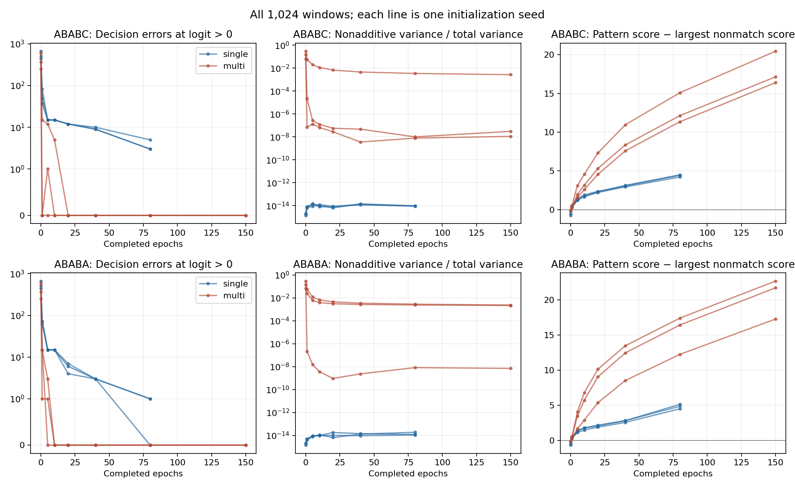
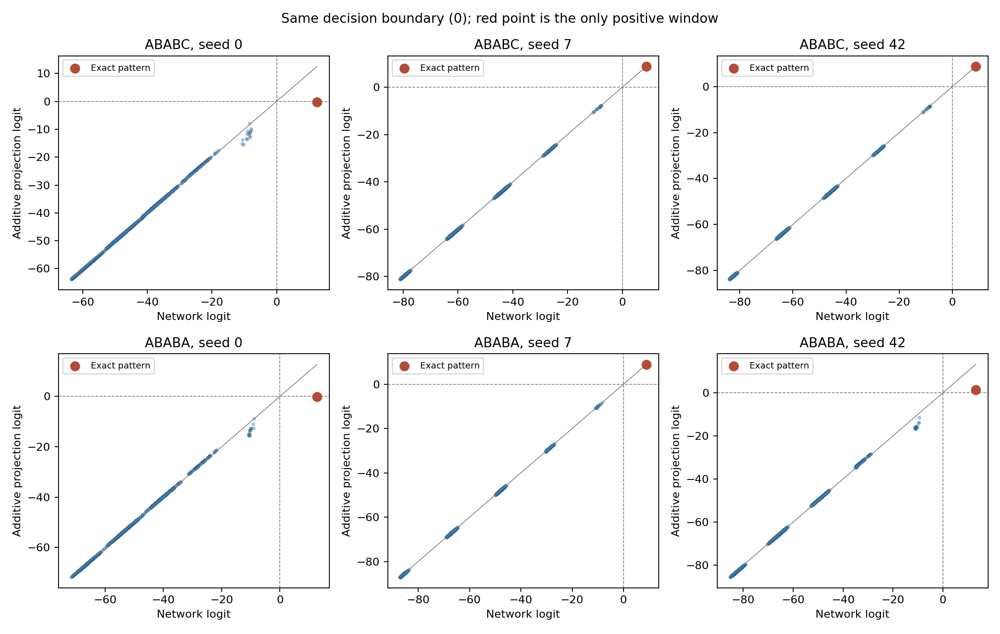

# Riconoscere un pattern ed eseguire una ricerca sono la stessa cosa?

Primo nucleo del progetto di Algoritmi Avanzati — 25 ottobre 2026.

**Risultato iniziale:** una CNN può rappresentare esattamente il riconoscimento
di un pattern senza eseguire la procedura di ricerca di KMP o Boyer–Moore.
I pesi possono inoltre conservare abbastanza informazione da ricostruire il
preprocessing classico. Occorre distinguere la funzione rappresentata, il modo
in cui viene appresa e l'algoritmo che la usa per attraversare il testo.

Le proposizioni sotto sono deduzioni dal modello del repository. Le misure
provengono da `experiment7.py`, eseguito su CPU: 12 training, 90 checkpoint,
valutazione di tutte le 1.024 finestre per checkpoint. I dati e i pesi sono
salvati in [`results/exhaustive/`](../results/exhaustive/).

## 1. Una specifica comune, tre livelli di confronto

Dati un pattern non vuoto P di lunghezza m e un testo T di lunghezza n,
restituire tutti gli indici s per cui T[s:s+m] = P, incluse le occorrenze
sovrapposte. Questa è la specifica del matching esatto in questo esperimento.

| Livello | Domanda | Criterio di verifica |
|---|---|---|
| Funzione locale | Questa finestra è P? | Tutte le finestre, compresi i quasi-match |
| Rappresentazione/preprocessing | Quale informazione del pattern è disponibile? | Recupero di P, tabelle derivate, margini, interazioni |
| Procedura di ricerca | Come si trovano tutte le occorrenze nel testo? | Correttezza degli output, confronti riusati e allineamenti esclusi |

KMP costruisce la funzione dei bordi e la usa durante la scansione per
riutilizzare il prefisso già riconosciuto. Il lavoro complessivo è lineare
in m+n. [Knuth, Morris e Pratt, 1977](https://www.cs.jhu.edu/~misha/Spring23/Knuth77.pdf).

Boyer–Moore confronta dalla destra del pattern e usa il preprocessing per
escludere allineamenti. La baseline qui implementata usa solo la regola del
bad character, senza good suffix, e avanza di uno dopo un match completo:
non le attribuiamo tutte le proprietà dell'algoritmo completo.
[Boyer e Moore, 1977](https://www.cs.utexas.edu/~moore/publications/fstrpos.pdf).

La CNN attuale valuta invece ogni finestra con gli stessi pesi. Condividere
i pesi tra posizioni non equivale a riutilizzare l'esito dei confronti tra
finestre. Inoltre `sp` è una tabella statica: è la procedura KMP a mantenere
uno stato durante la scansione.

## 2. Tre proposizioni che rendono preciso il confronto

### Una sola convoluzione basta per il riconoscimento esatto

Poniamo w[i,c] = 1 se c=P[i], 0 altrimenti, e b=1/2−m. Il logit su W è

    f(W) = 1/2 − d_H(W,P).

Quindi f(W)>0 se e solo se W=P. È una costruzione esplicita, senza training,
valida per ogni pattern su un alfabeto finito. Qui la dimensione del kernel
è m: non stiamo sostenendo che un kernel di dimensione costante risolva
pattern arbitrariamente lunghi.

Questo distingue **capacità di rappresentare la risposta** e **capacità di
eseguire una particolare ricerca efficiente**. I risultati di espressività
di Merrill riguardano architetture e nozioni di accettazione asintotica
precise, con ipotesi sulla computazione e sulla precisione. Non costituiscono
da soli una prova di impossibilità per questo classificatore a finestra di
dimensione m o per tutti gli MLP su pattern di lunghezza limitata.
[Merrill, 2019](https://aclanthology.org/W19-3901.pdf).

### L'identità in penalità non è una scoperta del training

Per qualunque filtro, anche casuale, scegliamo Q[i] tra gli argmax della riga
e definiamo pen[i,c]=w[i,Q[i]]−w[i,c] e pi=b+sum_i w[i,Q[i]]. Allora

    f(W) = pi − sum_i pen[i,W[i]].

È una riscrittura algebrica. Le penalità sono non negative, ma Q non è
necessariamente il pattern bersaglio prima dell'apprendimento. Quando ogni
argmax è unico e Q=P, sia delta la minima penalità su un simbolo scorretto.
Allora delta>0 e il matching con penalità cumulativa ≤tau è esatto per
0≤tau<delta. Per la regola f(W)>t, l'intervallo esatto è
pi−delta≤t<pi. Non è garantito che il valore t=0 appartenga all'intervallo.

Il training deve quindi essere studiato per il recupero di P, la gerarchia
delle penalità e la separazione dei punteggi. Il segno assoluto dei pesi
non basta: traslare ogni riga e compensare il bias conserva la funzione.

### Recuperare il pattern permette di costruire anche sp e Z

Se le righe hanno argmax unico e corretto, i pesi determinano P. Possiamo
estrarlo e calcolare `sp(P)` o `Z(P)` con le routine classiche. Non è dunque
corretto concludere che nei pesi manchi necessariamente l'informazione
richiesta da `sp`; può essere presente attraverso il pattern stesso.

Questo non prova che la rete abbia imparato a calcolare `sp` né che lo usi.
L'estrazione e il preprocessing sono operazioni esterne. La domanda diventa:
**quale parte del lavoro compie la rete, e quale il compilatore/scanner
classico che le affianchiamo?**

## 3. Protocollo sperimentale

- Pattern: `ABABC` e `ABABA`, alfabeto `ABCD`, tutte le 4^5 finestre.
- Modelli: filtro singolo; quattro filtri, ReLU e combinazione lineare.
- Inizializzazioni: semi 0, 7, 42. Dati e ordine dei batch fissati a seed 0.
- Training originale: 2.000 testi e 80 epoche per il filtro singolo;
  4.000 testi e 150 epoche per il multifiltro. Adam, batch 64, peso positivi
  20; learning rate rispettivamente 0,01 e 0,005. Testi di lunghezza 50,
  due match e quattro near-miss piantati, etichette ricalcolate sul testo finale.
- Checkpoint: inizializzazione, epoche 1, 5, 10, 20, 40, 80 e, per il
  multifiltro, 150. L'osservazione non riavvia Adam.
- Decisione fissata: logit>0. Misuriamo anche se esiste una soglia esatta,
  controllando che il pattern abbia punteggio maggiore di ogni non-match.

I budget dei due modelli sono diversi perché riprendono gli esperimenti
esistenti: questo non è un confronto dell'efficienza di apprendimento a
budget uguale. I semi misurano la variazione d'inizializzazione, non quella
tra dataset. L'enumerazione descrive la funzione completa e non misura
generalizzazione a nuovi pattern o nuove lunghezze.

Per ogni funzione f, sotto la distribuzione uniforme delle finestre, poniamo
mu=E[f] e g_i(c)=E[f|W_i=c]−mu. La proiezione additiva è

    a(W) = mu + sum_i g_i(W_i),       r(W) = f(W) − a(W).

Le coordinate sono indipendenti e gli effetti sono centrati: questa è la
proiezione ortogonale sullo spazio delle funzioni additive. Riportiamo
E[r²]/Var(f), errore massimo e disaccordi di decisione. Non è un surrogate
valutato fuori campione: usa deliberatamente l'intero dominio per descrivere f.

## 4. Che cosa abbiamo osservato

### Il pattern viene recuperato prima che la soglia diventi esatta

Tutti i sei filtri singoli recuperano il pattern già al primo checkpoint
dopo un'epoca. Al termine, alcuni accettano ancora quasi-match a soglia zero.

| Pattern | Modello | Falsi positivi, semi 0 / 7 / 42 | Falsi negativi | Esiste una soglia esatta? |
|---|---|---|---|---|
| ABABC | Singolo | 5 / 3 / 3 | 0 in tutti | Sì in tutti |
| ABABA | Singolo | 0 / 1 / 1 | 0 in tutti | Sì in tutti |
| ABABC | Multifiltro | 0 / 0 / 0 | 0 in tutti | Sì in tutti |
| ABABA | Multifiltro | 0 / 0 / 0 | 0 in tutti | Sì in tutti |

Il massimo errore dell'identità in penalità tra i checkpoint singoli è
2,86×10^-6; all'inizializzazione è già dell'ordine di 10^-8. L'additività
non compare insieme al recupero del pattern: era presente prima.



### Quasi additivo nei punteggi non significa identico nelle decisioni

Il multifiltro raggiunge la stessa funzione di classificazione esatta con
funzioni di punteggio diverse tra inizializzazioni. Il caso seed 0 è istruttivo:

| Pattern | R² additivo | Logit del pattern nella rete | Logit nella proiezione | Decisione a soglia 0 |
|---|---:|---:|---:|---|
| ABABC | 0,997350 | +12,5464 | −0,1857 | Da accettato a rifiutato |
| ABABA | 0,997644 | +12,7134 | −0,2284 | Da accettato a rifiutato |

La varianza non additiva è piccola, ma il massimo residuo si concentra
proprio sul pattern. La proiezione perde l'unica finestra positiva, pur
concordando sulle altre 1.023. Una metrica globale può nascondere questo
effetto a causa dello sbilanciamento del dominio.

**Controllo della soglia:** in entrambi i casi il pattern resta il massimo
anche nella proiezione, con distacco rispettivamente 7,6407 e 8,5747 dal
miglior negativo. Esiste quindi una ricalibrazione che ripristina il matching
esatto. Non abbiamo dimostrato che le interazioni siano necessarie per
risolvere il task: abbiamo mostrato che eliminarle cambia la calibrazione e
può invalidare la sostituzione diretta a soglia fissata. In tutti i sei
multifiltro la proiezione ammette una soglia esatta.



Con seed 7 i residui massimi sono invece circa 0,057 e 0,049, senza
disaccordi a soglia zero. Possiamo quindi studiare perché l'ottimizzazione
produca soluzioni quasi perfettamente additive oppure correzioni concentrate
sui match, pur ottenendo la stessa classificazione.

## 5. Che cosa accelera davvero la ricerca?

Dal filtro singolo finale estraiamo P e le penalità. Confrontiamo la scansione
con penalità apprese con quella ottenuta dal template binario, fissando
**tau=eta=0**. Questa scelta realizza il matching esatto, ma può cambiare le
decisioni rispetto al classificatore originale a logit>0.

In tutte le 18 combinazioni di pattern, seed e tipo di testo, tutti gli
scanner restituiscono le occorrenze esatte. Le penalità binarie e apprese
producono anche gli stessi conteggi. La ragione è strutturale: a soglia zero
la scansione dipende solo dalle posizioni con penalità nulla, che coincidono.
I valori delle penalità positive non influiscono su accettazioni o shift.

Esempio con ABABA, testi di 20.000 caratteri:

| Procedura | Fondo uniforme | Match e near-miss piantati | Testo periodico ABAB… |
|---|---:|---:|---:|
| Scansione completa, m lookup/finestra | 99.980 | 99.980 | 99.980 |
| Ingenuo con arresto al primo mismatch | 26.723 | 27.815 | 59.988 |
| KMP | 24.982 | 25.199 | 20.000 |
| Bad character da destra, senza good suffix | 8.360 | 9.449 | 59.988 |
| Penalità + shift da sinistra, binarie o apprese | 22.190 | 23.010 | 59.988 |

Le righe classiche contano confronti tra caratteri; quelle con penalità
contano lookup. Non sono misure di tempo, né un conteggio di tutte le
istruzioni. Il preprocessing e il training sono esclusi. La costruzione
attuale della tabella di shift in `experiment5.py` ha cicli annidati e costo
O(m²|Sigma|), anche se una costruzione con occorrenze aggiornate progressivamente
può ottenere O(m|Sigma|).

Sul testo periodico ABABA ha 9.998 occorrenze sovrapposte. Qui KMP evita
confronti ripetuti che il nostro scanner a penalità ancora esegue. Sul fondo
uniforme la baseline che confronta da destra esclude invece molti allineamenti.
L'esempio rende osservabile il diverso uso dell'informazione, senza assegnare
una vittoria generale a un metodo.

**Interpretazione:** la riduzione rispetto ai m lookup per finestra può
provenire dal controllo della ricerca. In questo regime esatto non abbiamo
evidenza di un ulteriore vantaggio dovuto ai valori continui appresi.

## 6. Quale lavoro interpretativo viene adesso?

**Aggiornamento:** l'intervento descritto qui sotto è stato eseguito ed è
documentato nei [risultati dell'esperimento 8](distribution-intervention-results.md),
con 36 training controllati e un confronto degli ordini dei caratteri.

La prossima domanda è controllata: tenendo P fisso, spostare i negativi
difficili modifica le penalità e la componente non additiva? Questo separa
l'influenza della struttura combinatoria del pattern da quella del generatore.

Il legame con gli algoritmi rimane esplicito: verificare se le differenze
apprese cambiano l'ordine utile dei confronti o diventano utili nel matching
approssimato, dove i valori positivi delle penalità contano davvero.
Per quest'ultimo occorre prima fissare una specifica, confrontare un matcher
classico appropriato e garantire che gli shift non saltino accettazioni.

La predizione neurale di Z/sp resta una seconda linea: il protocollo causale
della GRU attuale va corretto prima di interpretarne i risultati. Il paper
precedente non è stato ancora riscritto; questa nota costituisce la base
verificata per la revisione.

## Riproduzione e verifiche

```bash
.venv/bin/python experiment7.py
MPLCONFIGDIR=/tmp/matplotlib .venv/bin/python -m pytest -q
```

Il JSON salva protocollo, versioni e hash dei sorgenti. I file NPZ conservano
pesi, logits sull'intero dominio e loss; non contengono lo stato di Adam per
riprendere un training interrotto. Le figure sono esportate anche in PDF.

I test confrontano la proiezione con una soluzione indipendente ai minimi
quadrati, verificano componenti di interazione note e confrontano gli scanner
con una ricerca per sottostringhe su 7.650 coppie testo-pattern per scanner.
Un test controlla che osservare i checkpoint lasci invariati pesi e loss.
