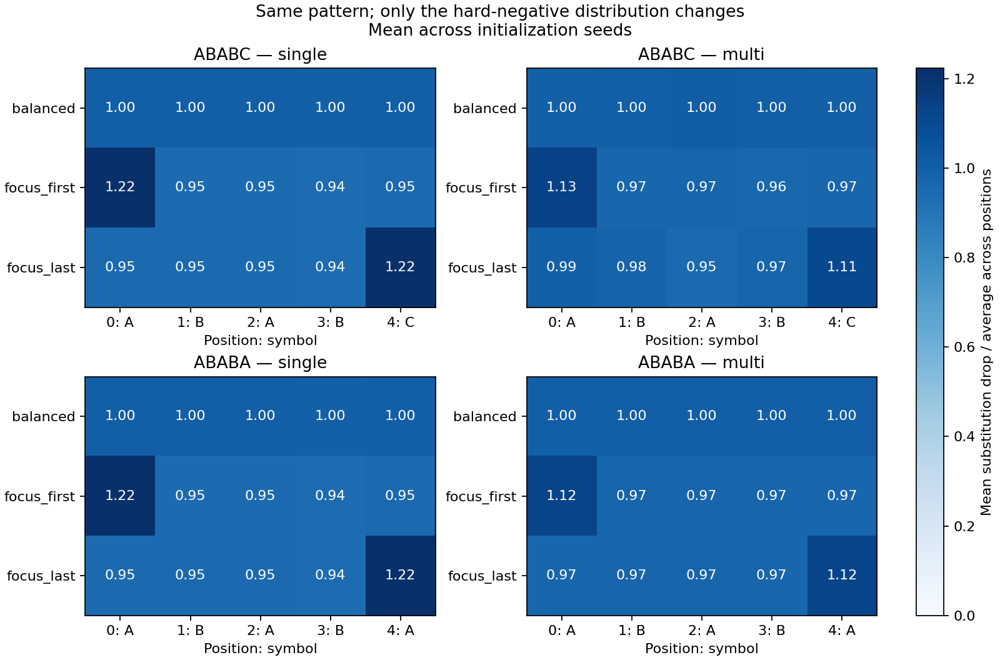
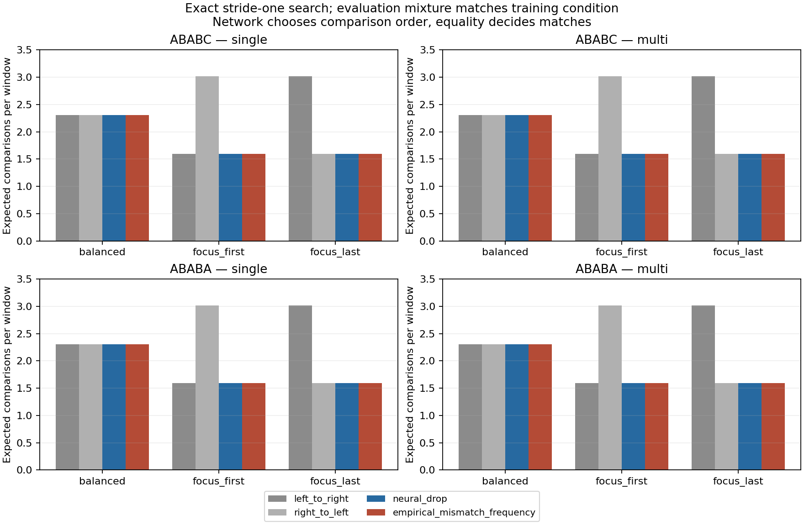

# Che cosa rappresentano le penalità: il pattern o i dati?

Secondo nucleo del progetto di Algoritmi Avanzati — 25 ottobre 2026.

**Risultato:** tenendo fisso il pattern, cambiare la frequenza dei quasi-match
sposta sistematicamente le penalità della rete, mentre tutte le decisioni
finali rimangono corrette. Questa informazione può suggerire un ordine utile
dei confronti. Nel controllo esaminato, però, una semplice statistica delle
frequenze ottiene lo stesso risparmio, senza training neurale.

L'esperimento segue la [prima analisi esaustiva](algorithmic-comparison-first-results.md).
Codice: `experiment8.py` e `distribution_controls.py`. Dati, pesi finali,
funzioni sui checkpoint e figure sono in
[`results/distribution-intervention/`](../results/distribution-intervention/).

## 1. Un intervento che conserva il problema

Il pattern rimane ABABC oppure ABABA. Anche le tabelle sp e Z rimangono
quindi fisse. In ogni condizione usiamo 2.400 finestre di lunghezza cinque:

| Componente | Numero | Modifica tra condizioni |
|---|---:|---|
| Pattern esatto, etichetta positiva | 120 | Nessuna |
| Negativi casuali uniformi fra le 1.023 finestre diverse da P | 1.140 | Nessuna: stesse finestre negli stessi slot |
| Quasi-match con esattamente una sostituzione | 1.140 | Cambia la frequenza della posizione errata |

Le tre condizioni distribuiscono i quasi-match così:

| Condizione | Posizione 0 | Posizione 1 | Posizione 2 | Posizione 3 | Posizione 4 |
|---|---:|---:|---:|---:|---:|
| Bilanciata | 228 | 228 | 228 | 228 | 228 |
| Concentrata sulla prima posizione | 912 | 57 | 57 | 57 | 57 |
| Concentrata sull'ultima posizione | 57 | 57 | 57 | 57 | 912 |

Per ogni posizione i tre simboli alternativi sono equiprobabili. Tutti i
15 tipi di quasi-match sono presenti in ogni condizione: cambia la loro
frequenza, non l'insieme degli esempi distinguibili. L'intero supporto del
training resta uguale tra condizioni, così come il 5% di positivi.

**Differenza rispetto al primo esperimento:** addestriamo su finestre
indipendenti. Questo elimina gli effetti di confine e sovrapposizione del
generatore di testi, che potrebbero cambiare involontariamente le etichette
o la frequenza dei positivi. L'esperimento identifica l'effetto nel protocollo
controllato, non dimostra che tutta la struttura dei precedenti filtri fosse
dovuta a questo singolo meccanismo.

Usiamo due architetture, due pattern e tre inizializzazioni (0, 7, 42),
per 36 training. Ogni confronto tra condizioni riusa la stessa
inizializzazione, lo stesso fondo casuale e lo stesso ordine dei batch.
Entrambe le architetture hanno 80 epoche, batch 64, Adam e peso positivi 20;
learning rate 0,01 per il filtro singolo e 0,005 per il multifiltro K=4.
Dati e shuffle hanno seed 0. Salviamo la funzione alle epoche 0, 1, 5, 20, 80:
180 valutazioni complete delle 1.024 finestre.

## 2. Misurare lo stesso oggetto nelle due architetture

Definiamo l'effetto di una sostituzione:

    D[i,c] = f(P) − f(P con il simbolo c alla posizione i).

Per il filtro singolo D coincide con la differenza tra i pesi del simbolo
corretto e quello sostituito; se P è recuperato correttamente, è la penalità.
Per il multifiltro D è invece un effetto misurato attorno a P: non lo
interpretiamo come una penalità indipendente dal contesto su tutte le finestre.

Riportiamo la media sui tre simboli scorretti, d[i], e la normalizzazione
d[i]/media_j d[j]. Quest'ultima separa la gerarchia delle posizioni dalla
scala complessiva dei logits. Il contrasto principale è

    C = (d[0] − d[4]) / media_j d[j].

Confrontiamo C fra le condizioni appaiando pattern, architettura e seed.
Le differenze tra semi sono riportate come intervalli osservati; non sono
intervalli di confidenza sulla popolazione di tutti i pattern o dataset.

## 3. Stessa funzione booleana, rappresentazioni diverse

**Tutti i 36 modelli finali classificano correttamente tutte le 1.024
finestre a soglia logit>0.** L'accuratezza finale non distingue le condizioni.
Le risposte alle sostituzioni, invece, cambiano nettamente.

Esempio: filtro singolo su ABABC, media delle tre inizializzazioni:

| Condizione | d[0] | d[1] | d[2] | d[3] | d[4] |
|---|---:|---:|---:|---:|---:|
| Bilanciata | 8,87 | 8,87 | 8,89 | 8,85 | 8,87 |
| Quasi-match sulla prima posizione | 10,03 | 7,75 | 7,75 | 7,70 | 7,77 |
| Quasi-match sull'ultima posizione | 7,74 | 7,75 | 7,75 | 7,70 | 10,00 |

La posizione che riceve più negativi difficili ottiene l'effetto di
sostituzione maggiore. Il comportamento compare in entrambi i pattern e
in entrambe le architetture. In tutti i 12 confronti appaiati, concentrare
sulla prima posizione aumenta C rispetto al controllo bilanciato;
concentrare sull'ultima lo diminuisce.

| Architettura | C(prima) − C(bilanciata) | C(ultima) − C(bilanciata) |
|---|---:|---:|
| Filtro singolo | da +0,271 a +0,279 | da −0,280 a −0,271 |
| Multifiltro | da +0,139 a +0,185 | da −0,184 a −0,011 |



L'effetto è coerente ma non identico in ogni training. Per esempio, sul
multifiltro ABABC con seed 42, concentrare i quasi-match sull'ultima posizione
produce un cambiamento del contrasto più piccolo: la rete non lineare può
redistribuire gli effetti in modo meno uniforme.

La piccola componente non additiva del multifiltro non scompare in ogni
condizione: la quota di varianza delle interazioni varia indicativamente
da 10^-8 a 2×10^-3 nei modelli finali. Questa osservazione descrive le
soluzioni ottenute; non stabilisce da sola il meccanismo dei singoli filtri.

## 4. Perché è plausibile, e che cosa abbiamo effettivamente dimostrato

Nel filtro singolo, il gradiente della cross-entropy rispetto a w[i,c] è

    (1/N) sum_x omega(y_x) * (sigmoid(f(x)) − y_x) * 1[x_i=c],

dove omega(1)=20 e omega(0)=1. Cambiare la frequenza degli esempi cambia
quindi la somma dei contributi al gradiente. La formula spiega un canale
attraverso cui i dati influenzano i pesi, ma non è una dimostrazione generale
di monotonicità delle penalità sotto Adam.

L'intervento mostra che, in questo protocollo, **le penalità non sono una
funzione soltanto del pattern o dei suoi bordi**: P, sp(P), Z(P) e tutte le
etichette corrette restano invariati, mentre cambiano i valori appresi.
Questo non esclude influenze della struttura del pattern in altri generatori.

È anche un esempio concreto di non unicità della rappresentazione:
molti punteggi diversi inducono lo stesso riconoscitore esatto. Un'analisi
basata solo su accuratezza o F1 non vede questa differenza.

## 5. Tradurre l'informazione appresa in una scelta algoritmica

Consideriamo un verificatore esatto di una finestra: sceglie un ordine delle
cinque posizioni, confronta i caratteri e termina al primo mismatch. Qualunque
permutazione è corretta: tutte le posizioni vengono controllate se non si
trova prima una prova di non uguaglianza.

Usiamo la rete soltanto per scegliere l'ordine, ordinando le posizioni per
d[i] decrescente. La decisione finale è affidata ai confronti di uguaglianza.
Confrontiamo questa scelta con:

- ordine da sinistra a destra;
- ordine da destra a sinistra;
- frequenza empirica decrescente dei mismatch nel training;
- miglior ordine fisso fra tutte le 120 permutazioni, conoscendo la
  distribuzione di valutazione (riferimento oracle, non risultato appreso).

I costi sono calcolati su tutte le finestre, pesate con la distribuzione
esatta della miscela: 5% match, 47,5% non-match uniformi, 47,5% quasi-match.
Non usiamo il campione finito di training per stimare il costo di valutazione.

### Una formula esatta per interpretare il risultato

Sia q_i la probabilità della posizione errata fra i quasi-match e r_i il
posto occupato dalla posizione i nell'ordine di confronto, da 1 a 5.
Un quasi-match richiede esattamente r_i confronti. Il costo atteso è

    E[costo] = 0,05 * 5 + 0,475 * (1359/1023) + 0,475 * sum_i q_i r_i.

Il termine 1359/1023 è il costo medio sui non-match uniformi: la somma dei
costi su tutte le 1.024 finestre è 1.364 e il match costa 5. Questo termine
non dipende dall'ordine, per la simmetria delle posizioni sotto quella
distribuzione.

Per minimizzare l'ultimo termine basta ordinare q_i in senso decrescente:
scambiare due posizioni che hanno probabilità in ordine opposto riduce o
conserva la somma. Questa è una spiegazione algoritmica del riferimento
ottimo, controllata anche enumerando tutte le permutazioni.

### Risultato a distribuzione corrispondente al training

| Distribuzione | Da sinistra | Da destra | Ordine neurale | Frequenze empiriche | Miglior ordine fisso |
|---|---:|---:|---:|---:|---:|
| Bilanciata | 2,3060 | 2,3060 | 2,3060 | 2,3060 | 2,3060 |
| Quasi-match sulla prima posizione | 1,5935 | 3,0185 | 1,5935 | 1,5935 | 1,5935 |
| Quasi-match sull'ultima posizione | 3,0185 | 1,5935 | 1,5935 | 1,5935 | 1,5935 |

Le medie attese coincidono, entro l'aritmetica numerica, in entrambi i pattern
e in tutti i seed e modelli. Nelle condizioni concentrate, la rete sceglie
sempre di controllare per prima la posizione più probabile. Le altre quattro
posizioni sono equivalenti nella popolazione, anche se gli ordini ricavati
dai diversi training non sono necessariamente identici.



Contro l'orientamento fisso sfavorevole, il costo passa da 3,0185 a 1,5935:
47,2% di confronti in meno, rapporto 1,89. **La regola delle frequenze ottiene
lo stesso risultato.** Qui non c'è evidenza che sia necessario addestrare
una rete per scegliere bene l'ordine.

### Cosa succede quando cambiano i dati di valutazione

Sulla distribuzione completamente uniforme delle 1.024 finestre, tutti gli
ordini costano 1,33203125 confronti in media: il vantaggio scompare.
Se addestriamo concentrando sulla prima posizione e valutiamo concentrando
sull'ultima, o viceversa, il costo dell'ordine neurale va da 1,9498 a 3,0185
nei run osservati, contro l'ottimo 1,5935.

La correttezza rimane esatta, perché dipende dai confronti, ma l'efficienza
dipende dalla distribuzione. È una separazione utile fra **garanzia di
correttezza** e **ipotesi statistiche necessarie al vantaggio di costo**.

## 6. Limiti del confronto e conseguenze per il progetto

Questo è un controllo del verificatore di singole finestre, senza salti e
senza riuso fra finestre. Non è un benchmark end-to-end contro KMP o
Boyer–Moore, né una misura del tempo su hardware. Le distribuzioni artificiali
di finestre non sono state costruite come finestre sovrapposte di un testo.
Il costo di training e quello di estrazione dell'ordine sono esclusi.

In particolare, non si può combinare arbitrariamente questo ordine con
la tabella di shift del primo esperimento: la regola e la sua prova di
correttezza vanno controllate per la procedura effettivamente usata.

I risultati provengono da due pattern, un solo seed dei dati e tre
inizializzazioni, con iperparametri fissati. Sono evidenza di un meccanismo
nel protocollo dichiarato, non una legge universale dei filtri CNN.

Il progetto ora distingue due tipi di informazione:

1. **Combinatoria:** P e le sue sovrapposizioni determinano il preprocessing
   classico e le garanzie di scansione.
2. **Statistica:** la distribuzione dei negativi influenza i margini e può
   suggerire quale confronto convenga tentare prima.

Il successivo approfondimento può verificare questo uso dei margini su
testi reali del generatore, con costi complessivi e cambi di distribuzione,
oppure studiare il matching approssimato con una specifica esplicita e
shift dimostrabilmente sicuri. Il confronto deve continuare a includere
baseline classiche che usano la stessa informazione statistica.

## Riproduzione

```bash
.venv/bin/python experiment8.py
MPLCONFIGDIR=/tmp/matplotlib .venv/bin/python -m pytest -q
```

Il JSON contiene risultati appaiati, metriche, costi anche su distribuzioni
diverse dal training, protocollo e hash dei sorgenti. I dataset NPZ permettono
di verificare che positivi, fondo e supporto siano invariati. I pesi finali
sono in `parameters/`; `functions.npz` contiene le funzioni sui 180 checkpoint
e le loss. Le figure sono disponibili anche in PDF.

I nuovi test verificano gli invarianti dell'intervento, la normalizzazione
delle distribuzioni, il costo contro un verificatore scalare indipendente,
l'invarianza dell'ordine sul fondo uniforme e un caso noto di ordine ottimo.
